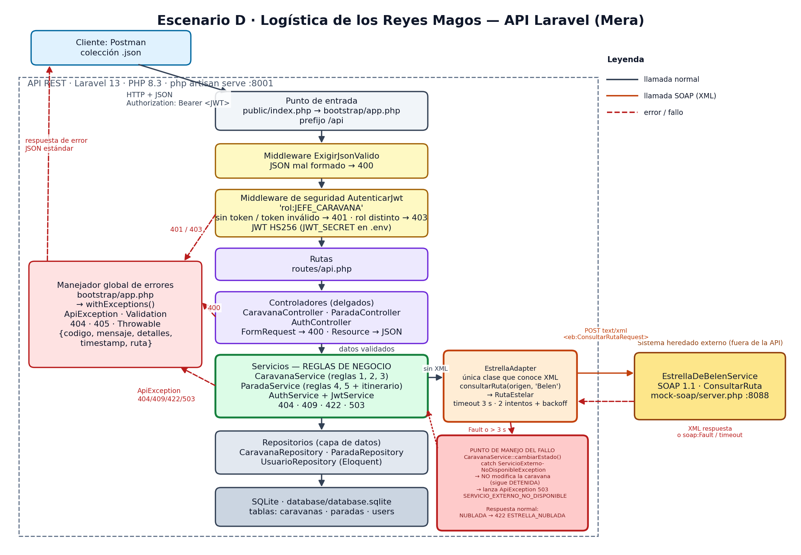

# 👑 API Caravanas de los Reyes Magos — Parcial 1 · Escenario D

**Estudiante:** Mera Camba Christian Gustavo (N.º 16) · **Escenario:** D · Logística de los Reyes Magos
**Stack:** PHP 8.3 · Laravel 13 · SQLite · JWT (HS256) · SOAP (EstrellaDeBelenService)

API REST para gestionar las caravanas de Melchor, Gaspar y Baltasar y su itinerario de paradas. Antes de poner una caravana en marcha se consulta el servicio SOAP heredado **EstrellaDeBelenService**; si falla, la API **no** responde 500: la caravana permanece `DETENIDA` y se responde **503** con el formato estándar de error.

---

## 1. Cómo levantar el proyecto

Requisitos: PHP 8.3 con extensiones `pdo_sqlite`, `dom`, `curl`, `mbstring`; Composer 2.

```bash
git clone <URL-del-repositorio> mera && cd mera
composer install
cp .env.example .env
touch database/database.sqlite
php artisan key:generate
php artisan jwt:secret            # genera JWT_SECRET en .env (no se sube al repo)
php artisan migrate:fresh --seed  # crea tablas y usuarios de prueba
```
> Atajo: `composer run setup` hace `install`, copia `.env`, crea la base y genera APP_KEY y JWT_SECRET. Luego `php artisan migrate:fresh --seed`.

Levantar (dos terminales):

```bash
# Terminal 1 – mock del servicio SOAP (WSDL en http://127.0.0.1:8088/estrella?wsdl)
php -S 127.0.0.1:8088 mock-soap/server.php        # o: composer run mock-soap

# Terminal 2 – API
php artisan serve --port=8001                      # o: composer run dev
```
API base: `http://127.0.0.1:8001/api`. Si el docente entrega su propio mock, solo cambia `ESTRELLA_SOAP_URL` en `.env`.

Pruebas automáticas (no necesitan el mock; usan `Http::fake`):
```bash
php artisan test     # 19 pruebas: reglas 1-5, 400/401/403/404/409/422, Fault, timeout y reintento
```

## 2. Variables de entorno

| Variable | Ejemplo | Uso |
|---|---|---|
| `JWT_SECRET` | *(vacío en el repo)* | Secreto HS256 para firmar tokens. Se genera con `php artisan jwt:secret`. |
| `JWT_TTL_MINUTOS` | `120` | Vigencia del token. |
| `ESTRELLA_SOAP_URL` | `http://127.0.0.1:8088/estrella` | Endpoint del servicio SOAP. |
| `ESTRELLA_SOAP_TIMEOUT` | `3` | Segundos máximos de espera por intento. |
| `ESTRELLA_SOAP_INTENTOS` | `2` | Intentos antes de declarar caído el servicio (extra: reintento con backoff). |
| `ESTRELLA_SOAP_BACKOFF_MS` | `300` | Espera entre intentos (exponencial). |
| `DEMO_JEFE_CLAVE`, `DEMO_PAJE_CLAVE` | `Caravana2026!`, `Paje2026!` | Claves de los usuarios de prueba que crea el seeder. |

`.env` está en `.gitignore`; en el repositorio solo existe `.env.example`.

## 3. Usuarios y tokens de prueba

| Usuario | Clave | Rol | Puede |
|---|---|---|---|
| `jefe.caravana` | `Caravana2026!` | `JEFE_CARAVANA` | todo |
| `paje` | `Paje2026!` | `PAJE` | solo endpoints públicos (en los protegidos recibe **403**) |

```bash
curl -X POST http://127.0.0.1:8001/api/auth/login -H "Content-Type: application/json" \
     -d '{"usuario":"jefe.caravana","clave":"Caravana2026!"}'
# → {"token":"eyJ...","tipo":"Bearer","rol":"JEFE_CARAVANA","expiraEn":"..."}
```
Usar el token en `Authorization: Bearer <token>`. Sin token → **401 TOKEN_AUSENTE**; token alterado → **401 TOKEN_INVALIDO**; rol distinto → **403 ROL_INSUFICIENTE**.
La colección de Postman hace el login y guarda los tokens sola (`tokenJefe`, `tokenPaje`).

## 4. Endpoints

| Método | Ruta | Descripción | Seguridad | Códigos |
|---|---|---|---|---|
| POST | `/api/auth/login` | Obtener JWT | pública | 200, 400, 401 |
| POST | `/api/caravanas` | Registrar caravana (nace DETENIDA) | JEFE_CARAVANA | 201, 400, 401, 403, 409 |
| GET | `/api/caravanas?estado=` | Listar (filtro opcional) | pública | 200, 400 |
| GET | `/api/caravanas/{id}` | Ver detalle con sus paradas | pública | 200, 404 |
| PUT | `/api/caravanas/{id}` | Actualizar (solo DETENIDA) | JEFE_CARAVANA | 200, 400, 401, 403, 404, 409 |
| PATCH | `/api/caravanas/{id}/estado` | Cambiar estado (reglas 1, 2, 3 + SOAP) | JEFE_CARAVANA | 200, 400, 401, 403, 404, 409, 422, **503** |
| POST | `/api/caravanas/{id}/paradas` | Agregar parada (regla 5) | JEFE_CARAVANA | 201, 400, 401, 403, 404, 409 |
| GET | `/api/caravanas/{id}/paradas` | Listar paradas por `orden` | pública | 200, 404 |
| PATCH | `/api/paradas/{id}/estado` | Marcar CUMPLIDA o CANCELADA (regla 4) | pública | 200, 400, 404, 409 |
| DELETE | `/api/paradas/{id}` | Eliminar (solo PLANIFICADA) | JEFE_CARAVANA | 204, 401, 403, 404, 409 |
| GET | `/api/caravanas/{id}/itinerario` | **Extra:** paradas en orden, días totales, paradas faltantes | pública | 200, 404 |

Reglas implementadas (todas en `app/Services`):
1. Nace `DETENIDA`. Transiciones: `DETENIDA → EN_CAMINO`, `EN_CAMINO → DETENIDA | EN_BELEN`, `EN_BELEN → OFRENDA_ENTREGADA`; otra → **409** `TRANSICION_INVALIDA`.
2. A `EN_CAMINO` se consulta la estrella: `NUBLADA` → **422** `ESTRELLA_NUBLADA`.
3. A `EN_BELEN` ninguna parada puede seguir `PLANIFICADA` → **422** `PARADAS_PENDIENTES`.
4. No se cumple la parada *n* si la *n − 1* sigue `PLANIFICADA` → **409** `PARADA_FUERA_DE_ORDEN`.
5. No se agregan paradas en `EN_BELEN` u `OFRENDA_ENTREGADA` → **409** `CARAVANA_CERRADA`.

Además: rey único (409 `REY_DUPLICADO`), ofrenda única (409 `OFRENDA_DUPLICADA`), `orden` único por caravana (409 `ORDEN_DUPLICADO`), caravana inexistente en paradas (404), una parada cerrada no se reabre (409) y solo se elimina si está `PLANIFICADA` (409 `PARADA_NO_ELIMINABLE`).

### Formato único de error
```json
{
  "codigo": "SERVICIO_EXTERNO_NO_DISPONIBLE",
  "mensaje": "El servicio EstrellaDeBelenService no está disponible; la caravana permanece DETENIDA. Intenta más tarde",
  "detalles": [{"servicio": "EstrellaDeBelenService", "motivo": "SOAP Fault soap:Server: Cielo cubierto", "intentos": 2, "estadoCaravana": "DETENIDA"}],
  "timestamp": "2026-12-01T10:15:00Z",
  "ruta": "/api/caravanas/2/estado"
}
```
Lo genera `App\Support\ErrorResponse`, invocado por el manejador global de `bootstrap/app.php` (400 · 401 · 403 · 404 · 405 · 409 · 422 · 503; un error inesperado también sale con este formato).

## 5. Integración SOAP y manejo de fallos

- `app/Adapters/EstrellaAdapter.php` es la **única** clase que conoce XML: arma el sobre `ConsultarRutaRequest` (origen de la caravana, destino `Belen`), lo envía por HTTP y devuelve el objeto de dominio `RutaEstelar(visibilidad, diasRestantes)`.
- Si recibe `soap:Fault`, no hay respuesta en **3 s** o el XML es ilegible, reintenta 1 vez (backoff 300 ms) y luego lanza `ServicioExternoNoDisponibleException` (excepción de dominio, sin XML).
- `CaravanaService::cambiarEstado()` la captura **antes de modificar nada**: la caravana sigue `DETENIDA` y se lanza `ApiException(503)`, que el manejador global convierte al formato estándar.

Comportamiento del mock local (`mock-soap/server.php`), según el `origen` de la caravana:

| `origen` | Respuesta del mock | Respuesta de la API |
|---|---|---|
| `Herodes` | `soap:Fault` · `soap:Server` · "Cielo cubierto" | **503**, sigue `DETENIDA` |
| `Desierto` | tarda 5 s (provoca timeout) | **503** (~6 s, 2 intentos), sigue `DETENIDA` |
| `Niebla` | `NUBLADA` | **422** `ESTRELLA_NUBLADA` |
| otro (p. ej. `Persia`) | `VISIBLE` + `diasRestantes` | 200 `EN_CAMINO` |

## 6. Arquitectura



Diagrama: [`docs/arquitectura.png`](docs/arquitectura.png) (también en [PDF](docs/arquitectura.pdf)).

```
Postman ──HTTP/JSON──► public/index.php
   ▲                     │
   │                     ▼
   │           Middleware ExigirJsonValido (400) ─► Middleware AutenticarJwt (401/403)
   │                     │
   │                     ▼
   │           routes/api.php ─► Controladores (delgados, FormRequest = 400)
   │                     │
   │                     ▼
   │           Servicios (REGLAS DE NEGOCIO: 404/409/422) ──► EstrellaAdapter ──XML──► EstrellaDeBelenService
   │                     │                                          │ Fault / >3 s
   │                     ▼                                          ▼
   │           Repositorios ─► SQLite          catch en CaravanaService → sigue DETENIDA + 503
   │
   └── Manejador global de errores (bootstrap/app.php) → {codigo, mensaje, detalles, timestamp, ruta}
```

| Capa | Carpeta | Responsabilidad |
|---|---|---|
| Rutas | `routes/api.php` | URL + método → controlador; aplica `rol:JEFE_CARAVANA`. |
| Seguridad | `app/Http/Middleware/AutenticarJwt.php`, `app/Services/JwtService.php` | Valida el JWT (401) y el rol (403). |
| Controladores | `app/Http/Controllers` | Delgados: reciben la petición validada, llaman al servicio, eligen el código HTTP. |
| Validación de formato | `app/Http/Requests` | Tipos, rangos, enums → 400. |
| Servicios | `app/Services` | **Todas** las reglas de negocio y el manejo del fallo SOAP. |
| Adaptador | `app/Adapters/EstrellaAdapter.php` | XML ↔ dominio, timeout, reintento. |
| Datos | `app/Repositories`, `app/Models`, `database/migrations` | Acceso a SQLite vía Eloquent. |
| Dominio | `app/Domain` | Enums, tabla de transiciones y `RutaEstelar`. |
| Errores | `bootstrap/app.php`, `app/Support/ErrorResponse.php`, `app/Exceptions` | Formato único de error. |

## 7. Colección de Postman

`postman/Parcial1-EscenarioD-ReyesMagos.postman_collection.json` (46 peticiones con tests). Para ejecutarla completa:
1. `php artisan migrate:fresh --seed` (base limpia: solo puede haber una caravana por rey).
2. Levantar mock y API.
3. Postman → Import → Runner → Run (en orden).

Cubre: 201/200 (crear y consultar), 400, 401, 403, 404, 409 (transición, duplicados, orden de paradas, caravana cerrada), 422 (estrella nublada, paradas pendientes), **503 por SOAP caído** (Fault y timeout, comprobando que la caravana sigue DETENIDA) y el extra `/itinerario`.

## 8. Respuesta: ¿y si fueran microservicios?

Separaría tres servicios: **Caravanas** (rey, ofrenda, camellos y la máquina de estados; su base solo tiene `caravanas`), **Itinerarios** (paradas, su orden y la regla de cumplirlas en orden; guarda `caravanaId` como referencia, no como clave foránea) y **Navegación** (único dueño del adaptador SOAP y del XML de la Estrella). La identidad (JWT) podría ser un cuarto servicio. Para pasar a `EN_BELEN`, Caravanas pregunta a Itinerarios si quedan paradas `PLANIFICADA`. Si Itinerarios cae el 24 de diciembre a las 23:00, Caravanas no puede verificar la regla 3: con timeout y circuit breaker responde 503 y la caravana queda `EN_CAMINO` (no se arriesga a llegar con paradas pendientes); el resto sigue funcionando. Si cae Navegación, igual que hoy: 503 y la caravana sigue `DETENIDA`.
